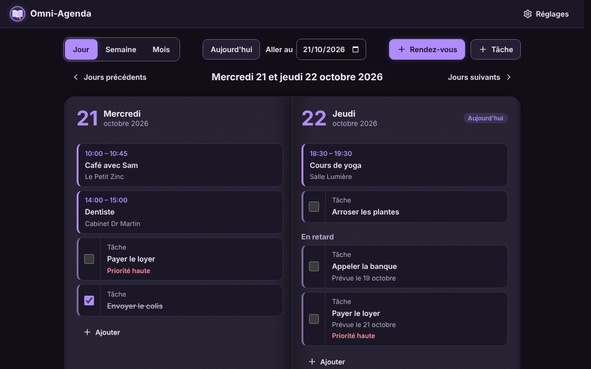
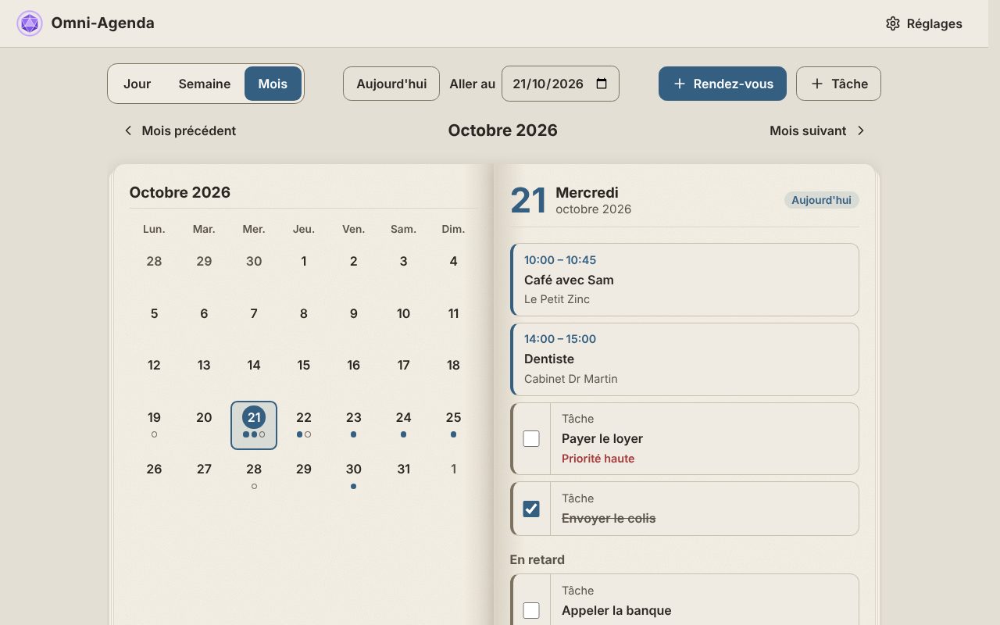
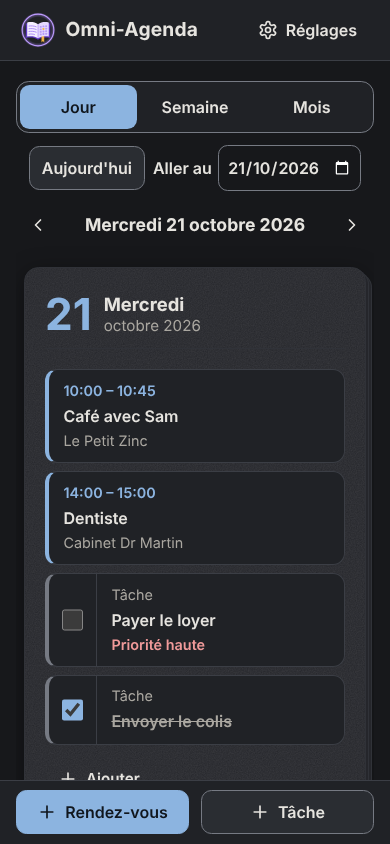

# Omni-Agenda

**Omni-Agenda** est un agenda privé qui fonctionne entièrement sur ton appareil :
pas de serveur, pas de compte, pas de publicité, et il marche sans internet.
Tes rendez-vous et tes tâches restent chez toi.



| Vue Mois, thème Clair | Sur téléphone, thème Sombre |
| --- | --- |
|  |  |

*(Les captures montrent des données d'exemple.)*

---

## Sommaire

1. [Ce que fait Omni-Agenda](#1-ce-que-fait-omni-agenda)
2. [Quelques mots à connaître](#2-quelques-mots-à-connaître)
3. [Lancer Omni-Agenda sur ton ordinateur](#3-lancer-omni-agenda-sur-ton-ordinateur)
4. [Tester](#4-tester)
5. [GitHub et installation](#5-github-et-installation)
6. [Modifier l'application plus tard](#6-modifier-lapplication-plus-tard)
7. [Organisation des fichiers](#7-organisation-des-fichiers)
8. [Confidentialité et sécurité](#8-confidentialité-et-sécurité)
9. [Limites connues](#9-limites-connues)
10. [Polices, licences et crédits](#10-polices-licences-et-crédits)
11. [Licence](#11-licence)

---

## 1. Ce que fait Omni-Agenda

- **Rendez-vous** : titre, date, **journée entière** (sur un ou plusieurs jours) ou heures de début et de fin, **récurrences** (quotidienne, hebdomadaire, mensuelle, annuelle avec fin par date ou nombre d'occurrences), lieu, description, rappel facultatif.
- **Tâches** : titre, échéance facultative, récurrence facultative, priorité, case « faite », description.
- **Vues Jour, Semaine et Mois**, présentées comme un agenda papier (navigation bornée entre 1900 et 2200) :
  - deux pages et une reliure sur grand écran, avec une page qui tourne doucement ;
  - une seule page sur téléphone, que l'on change en glissant le doigt ou avec les boutons (grille mensuelle accessible `role="grid"` et marges `safe-area-inset` sur mobile).
- **Recherche locale** : barre de recherche instantanée (insensible aux accents, ligatures et majuscules) dans les titres, lieux, notes, dates, récurrences et tâches, accessible uniquement après déverrouillage.
- **Confirmation avant perte de saisie** : sur téléphone (bouton Retour) ou fermeture, une fenêtre demande confirmation si une fiche contient des modifications non enregistrées.
- **Descriptions enrichies** : gras, souligné et surlignage de couleur.
- **8 polices** au choix, toutes incluses (dont OpenDyslexic avec plage `unicode-range` latine, pour la dyslexie, et une police manuscrite).
- **3 thèmes** : Omni-système (sombre aux reflets violets), Sombre, Clair. **Taille du texte** réglable.
- **Export et import** :
  - sauvegarde complète au format `.json` (« Fusionner » ou « Remplacer », chiffrée avec un sel dédié à chaque export si un mot de passe est actif) ;
  - **export `.ics`** (format iCalendar RFC 5545) pour transférer rendez-vous et tâches vers un autre agenda (fichier non chiffré, avec avertissement si un mot de passe est actif).
- **Mot de passe facultatif et verrouillage automatique** : l'agenda est chiffré sur l'appareil, avec délai d'inactivité configurable (1, 5, 15, 30, 60 min ou jamais), verrouillage optionnel au masquage de l'onglet, protection retour cache navigateur (`bfcache`), synchronisation multi-onglets et option « Tout effacer » depuis l'écran de verrouillage.
- **Sans internet** et **installable** comme une application (Android, iPhone, ordinateur).
- **Rappels** : notifications discrètes sans son, dédupliquées entre onglets et mémorisées de façon salée/chiffrée.

---

## 2. Quelques mots à connaître

- **Navigateur** : le programme qui affiche les sites (Chrome, Firefox, Edge, Safari…).
- **Terminal** : une fenêtre où l'on tape des commandes. Sur Windows : « PowerShell » ; sur Mac : « Terminal ».
- **Serveur local** : un petit programme qui « sert » les fichiers d'Omni-Agenda à ton navigateur, sur ton propre ordinateur. Rien ne part sur internet.
- **Dépôt GitHub** : le dossier en ligne qui contient le code d'Omni-Agenda.
- **Branche** : une version du code dans le dépôt. La branche principale s'appelle en général `main`.
- **Hébergeur** : un service qui met des fichiers en ligne, à une adresse internet.

---

## 3. Lancer Omni-Agenda sur ton ordinateur

> **Pourquoi ne pas simplement double-cliquer sur `index.html` ?**
> Par sécurité, les navigateurs n'autorisent certaines fonctions (programme en plusieurs
> fichiers, mode hors ligne, chiffrement) que sur une adresse `http://localhost` ou `https://`.
> Il faut donc un petit serveur local. C'est rapide, voici comment faire.

### Étape 1 : récupérer le code

1. Ouvre la page du dépôt sur GitHub.
2. Clique sur le bouton vert **Code**, puis sur **Download ZIP**.
3. Décompresse le fichier ZIP (clic droit → « Extraire tout » sur Windows, double-clic sur Mac).

### Étape 2 : démarrer un serveur local

Choisis **une** des deux méthodes.

**Méthode A : avec Python** (souvent déjà installé sur Mac et Linux)

1. Sur Windows, installe Python depuis <https://www.python.org/downloads/>.
   Pendant l'installation, coche la case **« Add python.exe to PATH »**.
2. Ouvre un terminal **dans le dossier d'Omni-Agenda** (celui qui contient `index.html`) :
   - Windows : ouvre le dossier, clique dans la barre d'adresse, tape `powershell`, puis appuie sur Entrée ;
   - Mac : clic droit sur le dossier → « Nouveau terminal au dossier ».
3. Tape cette commande, puis appuie sur Entrée :
   - Windows : `py -m http.server 8080`
   - Mac et Linux : `python3 -m http.server 8080`

**Méthode B : avec Node.js**

1. Installe Node.js (version « LTS ») depuis <https://nodejs.org/>.
2. Ouvre un terminal dans le dossier d'Omni-Agenda (comme ci-dessus).
3. Tape : `npx http-server -p 8080 -c-1` puis Entrée (la première fois, réponds `y` si une question s'affiche).

### Étape 3 : ouvrir Omni-Agenda

1. Dans ton navigateur, va à l'adresse : **<http://localhost:8080>**
2. Omni-Agenda s'affiche.

Pour arrêter le serveur : dans le terminal, appuie sur **Ctrl + C**.

---

## 4. Tester

### Tests automatiques

**Dans le navigateur :**

1. Le serveur local étant lancé, ouvre : **<http://localhost:8080/tests/tests.html>**
2. Attends quelques secondes. Tu dois voir en vert : **« ✓ Les 82 tests sont réussis. »**

Ces tests vérifient notamment :
- les calculs de dates (1900–2200), fuseaux horaires et changements d'heure ;
- la protection contre le code piégé ;
- les événements sur journée entière, les récurrences, la recherche locale et l'export `.ics` ;
- la lecture des fichiers de sauvegarde `.json` ;
- le chiffrement, le verrouillage automatique, les rappels et la complétude du service worker (`sw.js`).

Ils ne touchent pas à ton agenda.

**En ligne de commande (avec Node.js) :**

- **Contrôles statiques** (aucune dépendance externe requise) :
  ```sh
  node tests/verifier-statique.mjs
  ```
  Vérifie la présence de `.nojekyll`, la règle CSP stricte, l'absence de scripts/styles inline, la syntaxe et la correspondance réciproque entre les fichiers référencés (`index.html`, CSS, `manifest.webmanifest`, modules JS) et `sw.js`.
- **Suite complète + E2E navigateur (Playwright)** :
  ```sh
  npm install --no-save playwright && npx playwright install chromium
  node tests/tester.js
  ```
  Exécute les tests de `tests/tests.html`, les scénarios E2E (verrouillage automatique, synchronisation multi-onglets `BroadcastChannel`, retour mobile, effacement complet `eraseEverything()`, recherche, récurrences, journée entière, export `.ics`) et la complétude du service worker.

### Vérifications à faire toi-même

Chaque vérification indique quoi faire, puis ce que tu dois constater (**→ Résultat attendu**).

**1. Agenda vide**
1. Ouvre une fenêtre de **navigation privée** (Ctrl + Maj + N dans Chrome), puis va à <http://localhost:8080>.
2. → Résultat attendu : le message « Bienvenue dans Omni-Agenda » s'affiche.
3. Va dans **Réglages** → **Exporter mon agenda**.
4. → Résultat attendu : « Ton agenda est vide : il n'y a encore rien à exporter. »

**2. Changement de thème**
1. **Réglages** → **Thème** → choisis « Clair », puis « Sombre », puis « Omni-système ».
2. → Résultat attendu : les couleurs changent tout de suite.
3. Recharge la page (F5).
4. → Résultat attendu : le dernier thème choisi est gardé, sans éclair de couleur au chargement.

**3. Sans internet**
1. Ouvre Omni-Agenda une fois, puis va dans **Réglages** → **Application**.
2. → Résultat attendu : « Omni-Agenda fonctionne sans internet ».
3. Arrête le serveur local (Ctrl + C dans le terminal), ou coupe ta connexion, puis recharge la page.
4. → Résultat attendu : Omni-Agenda s'ouvre quand même, avec tes données.

**4. Export puis import dans un autre navigateur**
1. Ajoute deux ou trois rendez-vous et tâches.
2. **Réglages** → **Exporter mon agenda**.
3. → Résultat attendu : un fichier `omni-agenda-AAAA-MM-JJ.json` arrive dans ton dossier Téléchargements.
4. Ouvre <http://localhost:8080> dans **un autre navigateur** (par exemple Firefox si tu utilises Chrome).
5. **Réglages** → **Importer un agenda** → choisis le fichier → **Fusionner**.
6. → Résultat attendu : tes rendez-vous et tâches apparaissent dans l'agenda.

**5. Mauvais mot de passe**
1. **Réglages** → **Mot de passe** → **Activer un mot de passe**.
2. Écris le mot de passe deux fois, coche « J'ai compris », puis valide.
3. Recharge la page.
4. → Résultat attendu : l'écran de verrouillage s'affiche.
5. Tape un **mauvais** mot de passe.
6. → Résultat attendu : « Mot de passe incorrect. Réessaie. »
7. Tape le **bon** mot de passe.
8. → Résultat attendu : l'agenda s'ouvre.
9. Pour aller plus loin, exporte l'agenda et importe le fichier dans un autre navigateur.
10. → Résultat attendu : le mot de passe du fichier est demandé.

**6. Rappels**
1. **Réglages** → **Rappels** → **Autoriser les rappels** → **Tester un rappel**.
2. → Résultat attendu : une notification discrète, sans son, apparaît.

---

## 5. GitHub et installation

### Mettre le code sur la branche `main` de GitHub

La branche principale d'un dépôt s'appelle en général `main`. Pour qu'elle contienne Omni-Agenda :

- **Si le travail est sur une autre branche** et qu'une pull request (demande de fusion) est ouverte :
  1. Onglet **Pull requests** → ouvre la demande.
  2. Clique sur **Merge pull request**, puis sur **Confirm merge**.
- **Si la branche `main` existe déjà** et que le travail est sur une autre branche, sans demande ouverte :
  1. Onglet **Pull requests** → **New pull request**.
  2. Choisis `base: main` et `compare:` la branche de travail.
  3. Clique sur **Create pull request**, puis **Merge pull request**, puis **Confirm merge**.
- **Pour un tout nouveau dépôt** :
  1. Sur GitHub, crée un dépôt avec **New repository**.
  2. Clique sur **uploading an existing file**, puis glisse-dépose **le contenu** du dossier d'Omni-Agenda (pas le dossier lui-même).
  3. Clique sur **Commit changes**.

### Installer Omni-Agenda comme une application

Installée, Omni-Agenda a son icône et s'ouvre dans sa propre fenêtre.

- **Sur ton ordinateur (Chrome ou Edge)** :
  1. Lance le serveur local (section 3) et ouvre <http://localhost:8080>.
  2. Clique sur l'icône d'installation, à droite de la barre d'adresse (ou passe par **Réglages** → **Application**).
  3. Une fois installée, Omni-Agenda s'ouvre même quand le serveur local est arrêté, grâce à sa copie hors ligne.
- **Sur un téléphone**, il faut d'abord publier Omni-Agenda sur internet, à une adresse qui commence par `https://`.
  Un téléphone ne peut pas installer une application depuis l'adresse locale de ton ordinateur.
  Les fichiers se publient tels quels, sans aucune étape de « construction », chez n'importe quel hébergeur de sites.
  Ensuite :
  - **Android (Chrome)** : ouvre l'adresse, puis menu **⋮** → **Installer l'application** (ou **Ajouter à l'écran d'accueil**) ;
  - **iPhone (Safari)** : ouvre l'adresse, puis bouton **Partager** → **Sur l'écran d'accueil**.

Dans tous les cas, **les données restent sur chaque appareil** : un hébergeur ne sert que les fichiers de l'application.

---

## 6. Modifier l'application plus tard

1. Modifie les fichiers sur ton ordinateur.
2. Recharge Omni-Agenda dans le navigateur : le bandeau **« Une nouvelle version d'Omni-Agenda est prête »** apparaît.
3. Clique sur **« Mettre à jour »** pour voir ta modification. Tant que tu ne cliques pas,
   rien ne change, même si tu fermes et rouvres l'application : la nouvelle version attend ton accord.
4. Pour garder ton travail, envoie les fichiers modifiés sur la branche `main` de GitHub
   (avec Git, ou par **Add file** → **Upload files** sur le site de GitHub).

Si Omni-Agenda est un jour publiée sur internet, la mise à jour fonctionne de la même façon : à la prochaine ouverture avec internet, elle télécharge la nouvelle version toute seule, puis propose « Mettre à jour ». Elle ne s'installe jamais par surprise.

Deux règles à respecter :

- **Si tu ajoutes un nouveau fichier** (`.js`, `.css`, police, icône…), ajoute-le aussi à la liste `FILES` du fichier `sw.js`, puis incrémente `CACHE_VERSION` dans `sw.js` (chaque version utilise un cache isolé `omni-agenda-v*` sans téléchargement parallèle inutile au démarrage).
  Sinon, il manquera quand l'application fonctionne sans internet.
- **Le numéro de version** affiché dans « À propos » (et dans les sauvegardes `.json` / `.ics`) se change dans `js/config.js` (`APP_VERSION`), à garder aligné avec `CACHE_VERSION` dans `sw.js`.

L'adresse du portfolio (bouton « Découvrir mon portfolio ») se change aussi dans `js/config.js` (`PORTFOLIO_URL`).

---

## 7. Organisation des fichiers

Le principe : un fichier par responsabilité. Les commentaires du code sont en français.

```
omni-agenda/
├── .nojekyll               Désactive Jekyll sur GitHub Pages
├── .gitignore              Ignore node_modules, package.json, fichiers temporaires
├── .github/workflows/
│   └── ci.yml              Intégration continue (Node 22 : syntaxe, statique, Playwright)
├── index.html              La page unique : tous les écrans (agenda, réglages, à propos, verrouillage)
├── manifest.webmanifest    Fiche d'identité de l'application (nom, icônes) pour l'installation
├── sw.js                   Le « service worker » : copie hors ligne versionnée, mises à jour, rappels
├── css/                    L'apparence
│   ├── themes.css          Couleurs des 3 thèmes et texture du papier
│   ├── fonts.css           Les 8 polices (dont OpenDyslexic avec plage unicode-range latine)
│   ├── base.css            Bases (tailles, focus clavier, animations réduites)
│   ├── components.css      Barre du haut, boutons, cartes, messages
│   ├── forms.css           Champs, fenêtres, éditeur de description
│   ├── entries.css         Rendez-vous et tâches dans les listes et la fiche
│   ├── agenda.css          Barre d'outils, vues Semaine et Mois
│   ├── paper.css           Le livre : pages, reliure, page qui tourne
│   └── security.css        Écran de verrouillage et champs de mot de passe
├── js/                     Le programme
│   ├── boot.js             Applique thème et police avant l'affichage (pas de flash)
│   ├── app.js              Point de départ : assemble toutes les pièces
│   ├── auto-lock.js        Verrouillage automatique (inactivité, masquage, bfcache)
│   ├── config.js           Nom, version, adresse du portfolio
│   ├── storage.js          Enregistrement sur l'appareil (IndexedDB)
│   ├── entries.js          Règles des rendez-vous et des tâches (journée entière, rappels)
│   ├── entry-store.js      La liste des entrées en mémoire
│   ├── dates.js            Dates, heures, fuseaux horaires, changements d'heure
│   ├── recurrence.js       Calcul et libellés des récurrences
│   ├── search.js           Recherche locale (insensible aux accents/ligatures/casse)
│   ├── ics.js              Export iCalendar RFC 5545 (.ics)
│   ├── sanitize.js         Nettoyage des descriptions (seuls gras, souligné, surlignage)
│   ├── backup.js           Fichier de sauvegarde (export, import, fusion)
│   ├── crypto.js           Chiffrement (PBKDF2 + AES-GCM)
│   ├── security.js         Mot de passe : activer, changer, désactiver, verrouiller, purger
│   ├── reminders.js        Calcul des rappels
│   ├── notifications.js    Affichage des rappels (dédupliqués, salés/chiffrés)
│   ├── offline.js          Mode hors ligne (inscription du service worker)
│   ├── install.js          Installation comme application
│   ├── router.js           Passage d'un écran à l'autre
│   ├── themes.js, fonts.js Thèmes, polices, taille du texte
│   ├── ui/                 Les éléments de l'interface (fenêtres, formulaires, recherche, réglages…)
│   └── views/              Les vues de l'agenda (jour, semaine, mois, livre)
├── assets/
│   ├── icons/              Logo (agenda ouvert) et icônes de l'application
│   └── fonts/              Polices et leurs licences
├── tests/                  Tests navigateur (tests.html), contrôles statiques (verifier-statique.mjs) et E2E CLI (tester.js)
└── docs/captures/          Captures d'écran de ce README
```

---

## 8. Confidentialité et sécurité

- **Aucune donnée ne quitte ton appareil.**
  - Pas de compte, pas de cookie, pas de statistiques, pas de publicité.
  - Une règle de sécurité (« Content Security Policy ») interdit à la page de charger quoi que ce soit venant d'un autre site.
- **Les seuls liens vers internet** sont le bouton « Découvrir mon portfolio » et le lien de la licence, tous deux sur la page « À propos ». Ils ne s'ouvrent que si tu les touches.
- **Mot de passe facultatif** :
  - chaque rendez-vous et chaque tâche est chiffré avec **AES-GCM 256 bits** ;
  - la clé est obtenue à partir du mot de passe avec **PBKDF2-SHA-256 (600 000 tours)** et un sel aléatoire ;
  - **le mot de passe n'est jamais enregistré** ;
  - le fichier exporté `.json` est chiffré lui aussi, avec son **propre sel aléatoire** à chaque export ;
  - **verrouillage automatique** configurable après inactivité, optionnel dès le masquage de l'onglet, verrouillage au retour depuis le cache navigateur (`bfcache`) et propagation instantanée aux autres onglets via `BroadcastChannel` ;
  - l'historique des rappels déjà affichés (`omni-agenda:rappels-affiches`) est **haché avec sel** et **chiffré** quand un mot de passe est actif ;
  - **« Tout effacer »** (en cas d'oubli du mot de passe) purge les entrées, le mot de passe, la date du dernier export, les réglages de verrouillage automatique, le sel et l'historique des rappels (seuls les réglages d'apparence sont conservés) ;
  - l'**export `.ics` n'est pas chiffré** (une confirmation explicite avec mot de passe est demandée si un mot de passe est actif).
- ⚠️ **Si tu perds ton mot de passe, personne ne peut récupérer les données.**
  Pense à exporter ton agenda de temps en temps et à garder le fichier en lieu sûr.
- Avec un mot de passe actif, **les rappels sont discrets** : ils n'affichent ni le titre ni le lieu.
- **Les descriptions sont nettoyées** : seuls le gras, le souligné et le surlignage sont gardés. Tout code caché est supprimé, y compris dans un fichier importé.

---

## 9. Limites connues

- **Les données sont propres à chaque navigateur.** Pour passer d'un appareil à l'autre, utilise **Exporter** puis **Importer**.
- **Les rappels** s'affichent si Omni-Agenda est ouverte, ou encore active en arrière-plan. Sans serveur, une application web ne peut pas se réveiller toute seule.
  Si l'application était fermée à l'heure du rappel, il s'affiche à la prochaine ouverture, tant que le rendez-vous n'a pas commencé.
- **Sur iPhone**, les notifications ne fonctionnent que si Omni-Agenda est installée sur l'écran d'accueil.
- **Le mot de passe et le mode hors ligne** demandent une adresse sécurisée (`https://`) ou `http://localhost`.

---

## 10. Polices, licences et crédits

- Les 7 polices ajoutées sont sous licence libre **SIL Open Font License 1.1** :
  Atkinson Hyperlegible, Lexend, OpenDyslexic, Andika, Literata, Nunito, Patrick Hand.
  Leurs licences sont dans `assets/fonts/licences/`, et leur origine est expliquée dans `assets/fonts/LISEZ-MOI.md`.
- **OpenDyslexic** : les règles `@font-face` dans `css/fonts.css` ciblent la plage `unicode-range` latine (français, ponctuation, `€`) sur les fichiers `.woff2` issus de `@fontsource` (jeu `latin`). Un sous-ensemble binaire plus fin peut être régénéré hors ligne avec `fonttools`/`pyftsubset` si nécessaire.
- Omni-Agenda n'utilise **aucune bibliothèque extérieure** : uniquement du HTML, du CSS et du JavaScript, sans outil de construction.

Application réalisée par **Ferrus Dantioch**, avec l'aide de l'**intelligence artificielle**.

---

## 11. Licence

**© 2026 Ferrus Dantioch — Creative Commons BY-NC-ND 4.0**
([résumé de la licence en français](https://creativecommons.org/licenses/by-nc-nd/4.0/deed.fr))

En clair : le partage est autorisé, à l'identique et en citant l'auteur ;
l'usage commercial est interdit ; la modification et les œuvres dérivées
sont interdites. Le logiciel est fourni « en l'état », sans aucune garantie.

Texte complet dans le fichier [LICENSE](LICENSE) : le texte officiel en
anglais, suivi de la traduction française officielle publiée par Creative
Commons.

Les polices gardent leur propre licence (voir la section 10).
