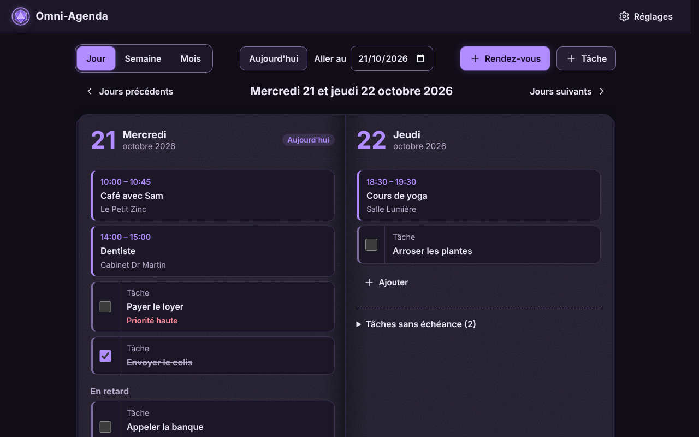
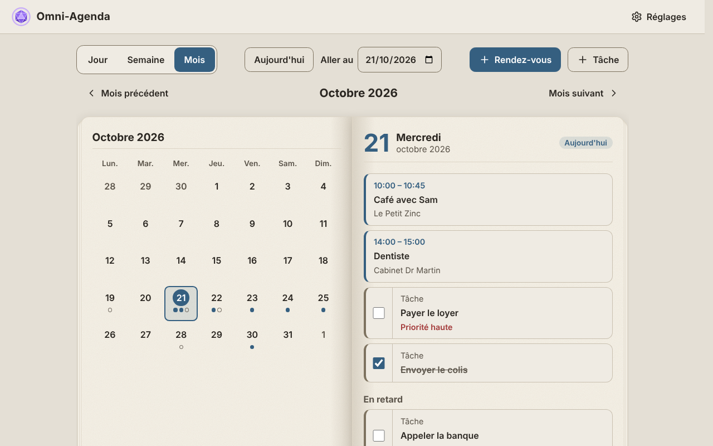
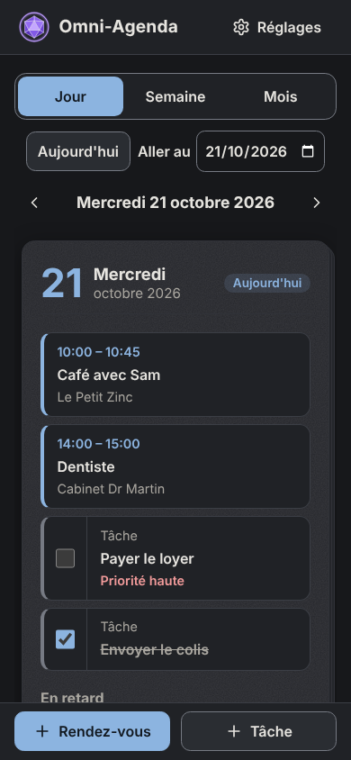

# Omni-Agenda

**Omni-Agenda** est un agenda privé qui fonctionne entièrement sur ton appareil :
pas de serveur, pas de compte, pas de publicité, et il marche sans internet.
Tes rendez-vous et tes tâches restent chez toi.



| Vue Mois, thème Clair | Sur téléphone, thème Sombre |
| --- | --- |
|  |  |

*(Les captures montrent des données d'exemple.)*

---

## Sommaire

1. [Ce que fait Omni-Agenda](#1-ce-que-fait-omni-agenda)
2. [Quelques mots à connaître](#2-quelques-mots-à-connaître)
3. [Lancer Omni-Agenda sur ton ordinateur](#3-lancer-omni-agenda-sur-ton-ordinateur)
4. [Tester](#4-tester)
5. [Publier sur internet : GitHub puis Netlify](#5-publier-sur-internet--github-puis-netlify)
6. [Modifier l'application plus tard](#6-modifier-lapplication-plus-tard)
7. [Organisation des fichiers](#7-organisation-des-fichiers)
8. [Confidentialité et sécurité](#8-confidentialité-et-sécurité)
9. [Limites connues](#9-limites-connues)
10. [Polices, licences et crédits](#10-polices-licences-et-crédits)

---

## 1. Ce que fait Omni-Agenda

- **Rendez-vous** : titre, date, heures de début et de fin, lieu, description, rappel facultatif.
- **Tâches** : titre, échéance facultative, priorité, case « faite », description.
- **Vues Jour, Semaine et Mois**, présentées comme un agenda papier :
  - deux pages et une reliure sur grand écran, avec une page qui tourne doucement ;
  - une seule page sur téléphone, que l'on change en glissant le doigt ou avec les boutons.
- **Descriptions enrichies** : gras, souligné et surlignage de couleur.
- **8 polices** au choix, toutes incluses (dont OpenDyslexic, pour la dyslexie, et une police manuscrite).
- **3 thèmes** : Omni-système (sombre aux reflets violets), Sombre, Clair. **Taille du texte** réglable.
- **Export et import** dans un fichier `.json`, avec le choix « Fusionner » ou « Remplacer », toujours après confirmation.
- **Mot de passe facultatif** : l'agenda est alors chiffré (illisible sans le mot de passe).
- **Sans internet** et **installable** comme une application (Android, iPhone, ordinateur).
- **Rappels** : notifications discrètes, sans son.

---

## 2. Quelques mots à connaître

- **Navigateur** : le programme qui affiche les sites (Chrome, Firefox, Edge, Safari…).
- **Terminal** : une fenêtre où l'on tape des commandes. Sur Windows : « PowerShell » ; sur Mac : « Terminal ».
- **Serveur local** : un petit programme qui « sert » les fichiers d'Omni-Agenda à ton navigateur, sur ton propre ordinateur. Rien ne part sur internet.
- **Dépôt GitHub** : le dossier en ligne qui contient le code d'Omni-Agenda.
- **Branche** : une version du code dans le dépôt. La branche principale s'appelle en général `main`.
- **Netlify** : un service gratuit qui publie le dépôt sur internet, à une adresse en `https://`.

---

## 3. Lancer Omni-Agenda sur ton ordinateur

> **Pourquoi ne pas simplement double-cliquer sur `index.html` ?**
> Par sécurité, les navigateurs n'autorisent certaines fonctions (programme en plusieurs
> fichiers, mode hors ligne, chiffrement) que sur une adresse `http://localhost` ou `https://`.
> Il faut donc un petit serveur local. C'est rapide, voici comment faire.

### Étape 1 : récupérer le code

1. Ouvre la page du dépôt sur GitHub.
2. Clique sur le bouton vert **Code**, puis sur **Download ZIP**.
3. Décompresse le fichier ZIP (clic droit → « Extraire tout » sur Windows, double-clic sur Mac).

### Étape 2 : démarrer un serveur local

Choisis **une** des deux méthodes.

**Méthode A : avec Python** (souvent déjà installé sur Mac et Linux)

1. Sur Windows, installe Python depuis <https://www.python.org/downloads/>.
   Pendant l'installation, coche la case **« Add python.exe to PATH »**.
2. Ouvre un terminal **dans le dossier d'Omni-Agenda** (celui qui contient `index.html`) :
   - Windows : ouvre le dossier, clique dans la barre d'adresse, tape `powershell`, puis appuie sur Entrée ;
   - Mac : clic droit sur le dossier → « Nouveau terminal au dossier ».
3. Tape cette commande, puis appuie sur Entrée :
   - Windows : `py -m http.server 8080`
   - Mac et Linux : `python3 -m http.server 8080`

**Méthode B : avec Node.js**

1. Installe Node.js (version « LTS ») depuis <https://nodejs.org/>.
2. Ouvre un terminal dans le dossier d'Omni-Agenda (comme ci-dessus).
3. Tape : `npx http-server -p 8080 -c-1` puis Entrée (la première fois, réponds `y` si une question s'affiche).

### Étape 3 : ouvrir Omni-Agenda

1. Dans ton navigateur, va à l'adresse : **<http://localhost:8080>**
2. Omni-Agenda s'affiche.

Pour arrêter le serveur : dans le terminal, appuie sur **Ctrl + C**.

---

## 4. Tester

### Tests automatiques

1. Le serveur local étant lancé, ouvre : **<http://localhost:8080/tests/tests.html>**
2. Attends quelques secondes. Tu dois voir en vert : **« ✓ Les 56 tests sont réussis. »**

Ces tests vérifient notamment :
- les calculs de dates et les changements d'heure ;
- la protection contre le code piégé ;
- la lecture des fichiers de sauvegarde ;
- le chiffrement et les rappels.

Ils ne touchent pas à ton agenda.

### Vérifications à faire toi-même

Chaque vérification indique quoi faire, puis ce que tu dois constater (**→ Résultat attendu**).

**1. Agenda vide**
1. Ouvre une fenêtre de **navigation privée** (Ctrl + Maj + N dans Chrome), puis va à <http://localhost:8080>.
2. → Résultat attendu : le message « Bienvenue dans Omni-Agenda » s'affiche.
3. Va dans **Réglages** → **Exporter mon agenda**.
4. → Résultat attendu : « Ton agenda est vide : il n'y a encore rien à exporter. »

**2. Changement de thème**
1. **Réglages** → **Thème** → choisis « Clair », puis « Sombre », puis « Omni-système ».
2. → Résultat attendu : les couleurs changent tout de suite.
3. Recharge la page (F5).
4. → Résultat attendu : le dernier thème choisi est gardé, sans éclair de couleur au chargement.

**3. Sans internet**
1. Ouvre Omni-Agenda une fois, puis va dans **Réglages** → **Application**.
2. → Résultat attendu : « Omni-Agenda fonctionne sans internet ».
3. Arrête le serveur local (Ctrl + C dans le terminal), ou coupe ta connexion, puis recharge la page.
4. → Résultat attendu : Omni-Agenda s'ouvre quand même, avec tes données.

**4. Export puis import dans un autre navigateur**
1. Ajoute deux ou trois rendez-vous et tâches.
2. **Réglages** → **Exporter mon agenda**.
3. → Résultat attendu : un fichier `omni-agenda-AAAA-MM-JJ.json` arrive dans ton dossier Téléchargements.
4. Ouvre <http://localhost:8080> dans **un autre navigateur** (par exemple Firefox si tu utilises Chrome).
5. **Réglages** → **Importer un agenda** → choisis le fichier → **Fusionner**.
6. → Résultat attendu : tes rendez-vous et tâches apparaissent dans l'agenda.

**5. Mauvais mot de passe**
1. **Réglages** → **Mot de passe** → **Activer un mot de passe**.
2. Écris le mot de passe deux fois, coche « J'ai compris », puis valide.
3. Recharge la page.
4. → Résultat attendu : l'écran de verrouillage s'affiche.
5. Tape un **mauvais** mot de passe.
6. → Résultat attendu : « Mot de passe incorrect. Réessaie. »
7. Tape le **bon** mot de passe.
8. → Résultat attendu : l'agenda s'ouvre.
9. Pour aller plus loin, exporte l'agenda et importe le fichier dans un autre navigateur.
10. → Résultat attendu : le mot de passe du fichier est demandé.

**6. Rappels**
1. **Réglages** → **Rappels** → **Autoriser les rappels** → **Tester un rappel**.
2. → Résultat attendu : une notification discrète, sans son, apparaît.

---

## 5. Publier sur internet : GitHub puis Netlify

Une fois publiée, Omni-Agenda a une adresse en `https://…`. Tu peux alors l'ouvrir et l'installer sur ton téléphone.
**Les données restent toujours sur chaque appareil** : Netlify ne sert que les fichiers de l'application.

### Étape 1 : le code sur la branche `main` de GitHub

Netlify publie une branche du dépôt. Le plus simple est que le code soit sur la branche `main`.

- **Si ton dépôt n'a qu'une seule branche avec un autre nom** (par exemple `ccr-…`), renomme-la `main` :
  1. Sur la page du dépôt, clique sur le nom de la branche (en haut à gauche de la liste des fichiers), puis sur **View all branches**.
  2. À droite de la branche, clique sur l'icône **crayon** (« Rename branch »).
  3. Écris `main`, puis clique sur **Rename branch**.
- **Si la branche `main` existe déjà** et que le travail est sur une autre branche :
  1. Onglet **Pull requests** → **New pull request**.
  2. Choisis `base: main` et `compare:` la branche de travail.
  3. Clique sur **Create pull request**, puis **Merge pull request**, puis **Confirm merge**.
- **Pour un tout nouveau dépôt** :
  1. Sur GitHub, crée un dépôt avec **New repository**.
  2. Clique sur **uploading an existing file**, puis glisse-dépose **le contenu** du dossier d'Omni-Agenda (pas le dossier lui-même).
  3. Clique sur **Commit changes**.

### Étape 2 : publier avec Netlify

1. Va sur <https://www.netlify.com/> et crée un compte avec **Sign up with GitHub**.
2. Clique sur **Add new project** (ou **Add new site**), puis **Import an existing project**.
3. Choisis **GitHub**, autorise Netlify si on te le demande, puis choisis le dépôt d'Omni-Agenda.
4. Vérifie les réglages :
   - **Branch to deploy** : `main` ;
   - **Build command** : laisse **vide** (Omni-Agenda n'a rien à « construire ») ;
   - **Publish directory** : `.` (un point). C'est déjà indiqué dans le fichier `netlify.toml`.
5. Clique sur **Deploy**. Au bout d'une minute environ, Netlify affiche l'adresse du site, par exemple `https://nom-au-hasard.netlify.app`.
6. Pour une adresse plus jolie : dans les réglages du projet sur Netlify, cherche **Change project name** (ou **Change site name**), puis choisis par exemple `omni-agenda-ferrus`. L'adresse devient `https://omni-agenda-ferrus.netlify.app`.

Le fichier `netlify.toml` ajoute automatiquement des règles de sécurité. Par exemple, il interdit l'affichage d'Omni-Agenda à l'intérieur d'un autre site.

### Étape 3 : installer Omni-Agenda sur ton téléphone

- **Android (Chrome)** : ouvre l'adresse Netlify, puis menu **⋮** → **Installer l'application** (ou **Ajouter à l'écran d'accueil**).
- **iPhone (Safari)** : ouvre l'adresse, puis bouton **Partager** → **Sur l'écran d'accueil**.
- **Ordinateur (Chrome ou Edge)** : clique sur l'icône d'installation à droite de la barre d'adresse.

Tu peux aussi passer par **Réglages** → **Application** dans Omni-Agenda.

---

## 6. Modifier l'application plus tard

1. Modifie les fichiers, puis envoie-les sur la branche `main` de GitHub (avec Git, ou par **Add file** → **Upload files** sur le site de GitHub).
2. Netlify publie automatiquement la nouvelle version en une minute environ.
3. À la prochaine ouverture avec internet, Omni-Agenda télécharge la nouvelle version tout seul.
4. Un bandeau discret propose alors **« Recharger maintenant »**.

Deux règles à respecter :

- **Si tu ajoutes un nouveau fichier** (`.js`, `.css`, police, icône…), ajoute-le aussi à la liste `FILES` du fichier `sw.js`.
  Sinon, il manquera quand l'application fonctionne sans internet.
- **Le numéro de version** affiché dans « À propos » se change dans `js/config.js` (`APP_VERSION`).
  Ce n'est pas obligatoire pour la mise à jour, mais c'est utile pour s'y retrouver.

L'adresse du portfolio (bouton « Découvrir mon portfolio ») se change aussi dans `js/config.js` (`PORTFOLIO_URL`).

> **Pendant que tu modifies sur ton ordinateur**, le mode hors ligne garde une copie de l'application.
> Après une modification, recharge la page : le bandeau « Une nouvelle version… » apparaît.
> Clique alors sur « Recharger maintenant » pour voir ta modification.

---

## 7. Organisation des fichiers

Le principe : un fichier par responsabilité. Les commentaires du code sont en français.

```
omni-agenda/
├── index.html              La page unique : tous les écrans (agenda, réglages, à propos, verrouillage)
├── manifest.webmanifest    Fiche d'identité de l'application (nom, icônes) pour l'installation
├── sw.js                   Le « service worker » : copie hors ligne, mises à jour, rappels
├── netlify.toml            Réglages de publication et règles de sécurité pour Netlify
├── css/                    L'apparence
│   ├── themes.css          Couleurs des 3 thèmes et texture du papier
│   ├── fonts.css           Les 8 polices
│   ├── base.css            Bases (tailles, focus clavier, animations réduites)
│   ├── components.css      Barre du haut, boutons, cartes, messages
│   ├── forms.css           Champs, fenêtres, éditeur de description
│   ├── entries.css         Rendez-vous et tâches dans les listes et la fiche
│   ├── agenda.css          Barre d'outils, vues Semaine et Mois
│   ├── paper.css           Le livre : pages, reliure, page qui tourne
│   └── security.css        Écran de verrouillage et champs de mot de passe
├── js/                     Le programme
│   ├── boot.js             Applique thème et police avant l'affichage (pas de flash)
│   ├── app.js              Point de départ : assemble toutes les pièces
│   ├── config.js           Nom, version, adresse du portfolio
│   ├── storage.js          Enregistrement sur l'appareil (IndexedDB)
│   ├── entries.js          Règles des rendez-vous et des tâches
│   ├── entry-store.js      La liste des entrées en mémoire
│   ├── dates.js            Dates, heures, fuseaux horaires, changements d'heure
│   ├── sanitize.js         Nettoyage des descriptions (seuls gras, souligné, surlignage)
│   ├── backup.js           Fichier de sauvegarde (export, import, fusion)
│   ├── crypto.js           Chiffrement (PBKDF2 + AES-GCM)
│   ├── security.js         Mot de passe : activer, changer, désactiver, verrouiller
│   ├── reminders.js        Calcul des rappels
│   ├── notifications.js    Affichage des rappels
│   ├── offline.js          Mode hors ligne (inscription du service worker)
│   ├── install.js          Installation comme application
│   ├── router.js           Passage d'un écran à l'autre
│   ├── themes.js, fonts.js Thèmes, polices, taille du texte
│   ├── ui/                 Les éléments de l'interface (fenêtres, formulaires, réglages…)
│   └── views/              Les vues de l'agenda (jour, semaine, mois, livre)
├── assets/
│   ├── icons/              Logo (dé à 20 faces) et icônes de l'application
│   └── fonts/              Polices et leurs licences
├── tests/                  Page de tests automatiques (tests.html)
└── docs/captures/          Captures d'écran de ce README
```

---

## 8. Confidentialité et sécurité

- **Aucune donnée ne quitte ton appareil.**
  - Pas de compte, pas de cookie, pas de statistiques, pas de publicité.
  - Une règle de sécurité (« Content Security Policy ») interdit à la page de charger quoi que ce soit venant d'un autre site.
- **Le seul lien vers internet** est le bouton « Découvrir mon portfolio » de la page « À propos ». Il ne s'ouvre que si tu le touches.
- **Mot de passe facultatif** :
  - chaque rendez-vous et chaque tâche est chiffré avec **AES-GCM 256 bits** ;
  - la clé est obtenue à partir du mot de passe avec **PBKDF2-SHA-256 (600 000 tours)** et un sel aléatoire ;
  - **le mot de passe n'est jamais enregistré** ;
  - le fichier exporté est chiffré lui aussi.
- ⚠️ **Si tu perds ton mot de passe, personne ne peut récupérer les données.**
  Pense à exporter ton agenda de temps en temps et à garder le fichier en lieu sûr.
- Avec un mot de passe actif, **les rappels sont discrets** : ils n'affichent ni le titre ni le lieu.
- **Les descriptions sont nettoyées** : seuls le gras, le souligné et le surlignage sont gardés. Tout code caché est supprimé, y compris dans un fichier importé.

---

## 9. Limites connues

- **Les données sont propres à chaque navigateur.** Pour passer d'un appareil à l'autre, utilise **Exporter** puis **Importer**.
- **Les rappels** s'affichent si Omni-Agenda est ouverte, ou encore active en arrière-plan. Sans serveur, une application web ne peut pas se réveiller toute seule.
  Si l'application était fermée à l'heure du rappel, il s'affiche à la prochaine ouverture, tant que le rendez-vous n'a pas commencé.
- **Sur iPhone**, les notifications ne fonctionnent que si Omni-Agenda est installée sur l'écran d'accueil.
- **Le mot de passe et le mode hors ligne** demandent une adresse sécurisée (`https://`) ou `http://localhost`.

---

## 10. Polices, licences et crédits

- Les 7 polices ajoutées sont sous licence libre **SIL Open Font License 1.1** :
  Atkinson Hyperlegible, Lexend, OpenDyslexic, Andika, Literata, Nunito, Patrick Hand.
  Leurs licences sont dans `assets/fonts/licences/`, et leur origine est expliquée dans `assets/fonts/LISEZ-MOI.md`.
- Omni-Agenda n'utilise **aucune bibliothèque extérieure** : uniquement du HTML, du CSS et du JavaScript, sans outil de construction.

Application réalisée par **Ferrus Dantioch**, avec la collaboration de **Claude** (IA développée par Anthropic).
